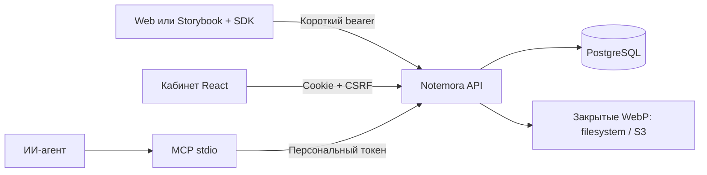

# Архитектура первой версии

## Данные и привязка

Проект объединяет приложение и Storybook. Обсуждение уникально по
`project + surface + pageKey + anchor.key`. SHA и build — контекст, не часть
идентичности блока: замечание остаётся видно после пересборки. `data-review-id`
даёт устойчивость, CSS selector — запасной способ найти элемент. Точка хранится
относительно блока в диапазоне 0…1, обводка рассчитывается по текущему DOM.

Контекст обсуждения описывает исходное создание; каждый снимок сохраняет своё
время, URL и viewport. URL не содержит query и fragment. В текущей версии build
и SHA передаёт клиент: связи с подтверждённым Git pipeline и сравнения коммитов
пока нет. Изменение DOM может потребовать нового `data-review-id`.

У сообщения есть автор, текст, срок жизни и статус снимка. Новый ответ имеет
собственный срок 7 суток. Вложение сначала находится в состоянии uploaded, затем
однократно привязывается к сообщению того же проекта и автора. Незавершённая
загрузка удаляется через час. Входное изображение декодируется и переупаковывается
в WebP без EXIF. Исходные PNG/JPEG не сохраняются.

`requestId` — UUID одного намерения отправки. Повтор с тем же содержимым возвращает
исходное сообщение. Повтор с другим содержимым или после удаления даёт 409.
Уникальные ограничения и блокировки PostgreSQL закрывают параллельные отправки.
Очистка пропускает блоки, которые сейчас изменяет другой запрос.

## Права

| Уровень                 | Полномочия                                       |
| ----------------------- | ------------------------------------------------ |
| Администратор платформы | Аккаунты, новые проекты, доступ ко всем проектам |
| Владелец проекта        | Настройки origins, участники и модерация         |
| Модератор               | Чтение, комментарии, удаление сообщений проекта  |
| Участник                | Чтение, комментарии, удаление своих сообщений    |

Доступ проверяется при каждом запросе, включая скачивание изображения.
Отозванное членство или отключённый аккаунт сразу ограничивают уже выданный PAT.
PAT дополнительно ограничивает проекты, срок и scopes; он не даёт доступ к
управлению аккаунтами или выпуску других токенов. Виджет привязан к origin,
проекту и родительской кабинетной сессии.

В базе хранятся Argon2-хеши паролей и digest секретов, приглашений и токенов.
Секрет PAT показывается один раз. Кабинетная сессия — HttpOnly cookie, 14 суток,
SameSite=Lax, в production Secure. Мутации требуют CSRF и точный origin кабинета.
Login ограничен 5 ошибками за 10 минут на email; внешний rate limit нужен при
публикации. Открытой саморегистрации и автоматической отправки писем нет.

CORS разрешает зарегистрированные origins, но сам по себе не предоставляет
доступ. Виджет отправляет bearer с `credentials: omit`. Сессия платформы отделена от пользовательских сессий приложения-потребителя.

## Очистка

Фильтр срока действует в каждом чтении API. Фоновая задача раз в 60 секунд
удаляет до 500 вложений и пустых обсуждений за проход; ошибки журналируются и
повторяются. Пока сервис выключен физической очистки нет. Ручной запуск:
`uv run review-admin purge`. Резервные копии и lifecycle объектного хранилища
настраиваются отдельно — сервис не гарантирует удаление данных из внешних backups.
